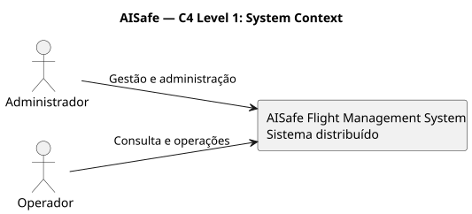
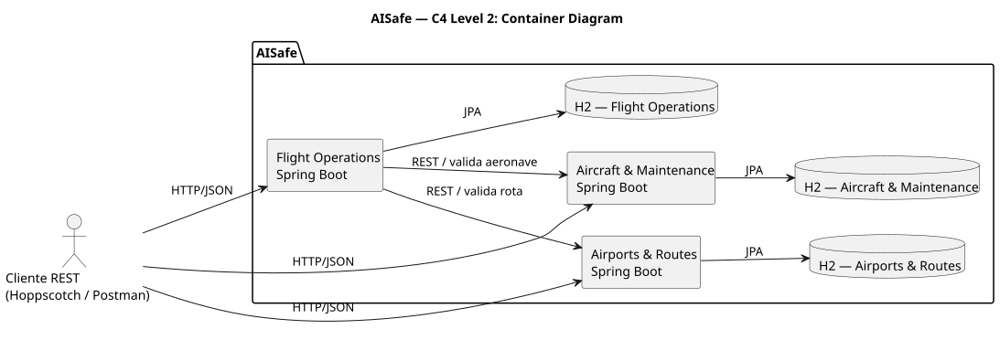
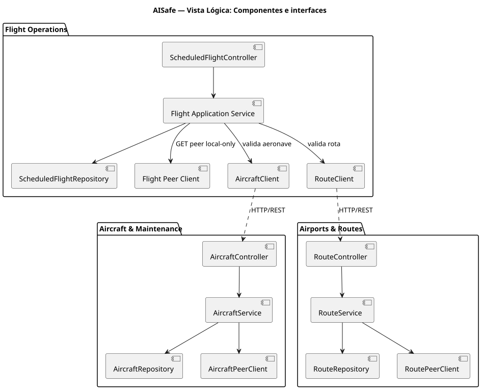
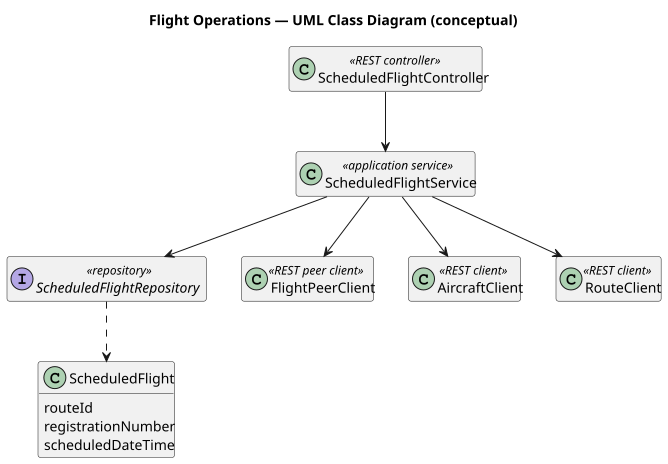
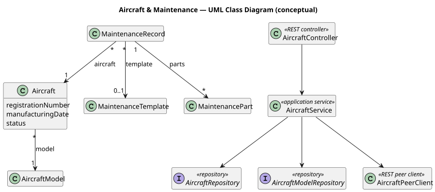
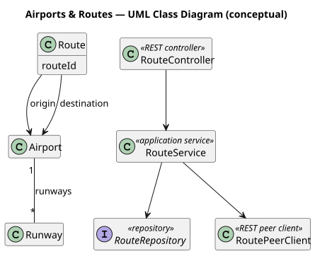
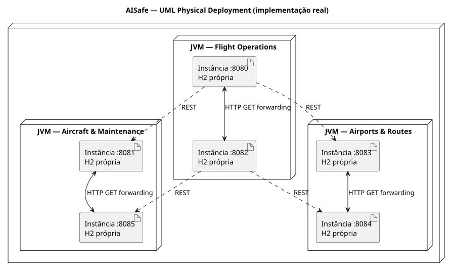
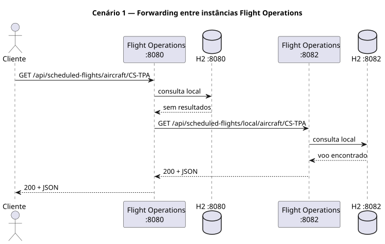
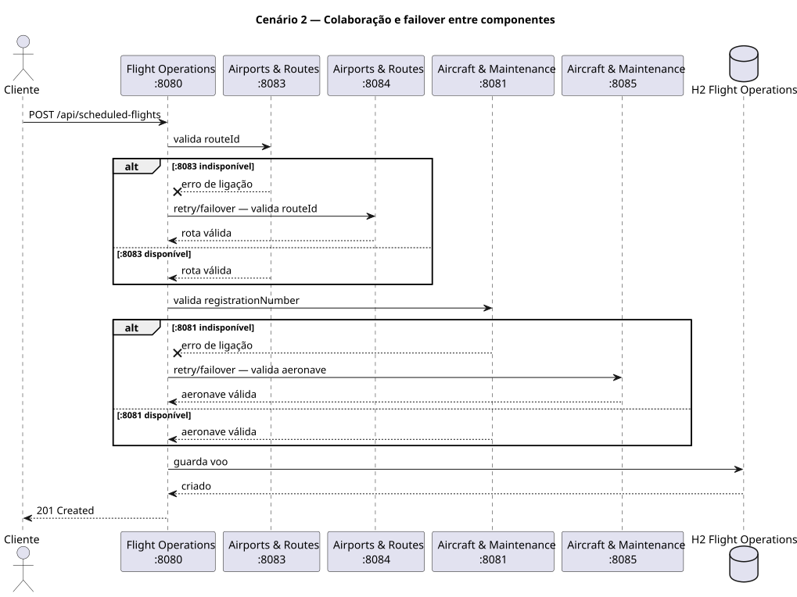
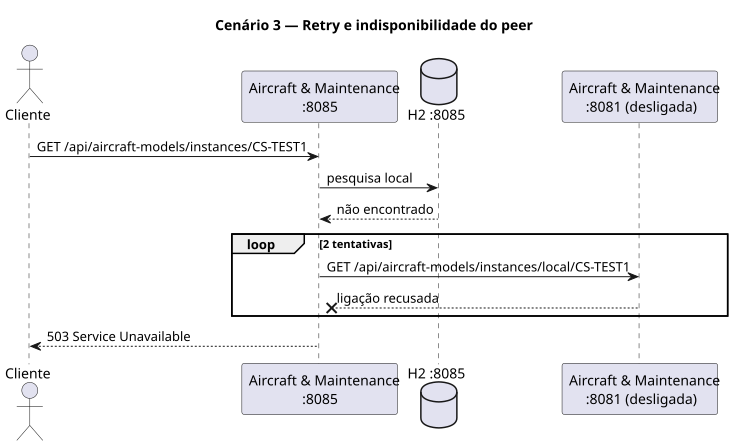

# AISafe Flight Management System
## Assignment 1 — Documentação arquitetural e de deployment

**Unidade curricular:** Sistemas Distribuídos (LETI / SIDIS)  
**Grupo:** Francisco Falcão (1222100), Raul Choupina (1230593), Gonçalo Maia (1221923)  


## 1. Visão geral e objetivos

O AISafe Flight Management System foi reorganizado a partir de uma aplicação monolítica para uma solução distribuída. O objetivo do Assignment 1 é demonstrar a segregação em componentes independentes, a execução simultânea de múltiplas instâncias, a comunicação HTTP/REST e o encaminhamento de pedidos quando os dados não existem localmente.

Adotou-se a designação **componentes de negócio implementados como aplicações Spring Boot independentes**. 

## 2. Domain-Driven Design (DDD) and Domain Segregation

### 2.1. Domain Analysis

O AISafe Flight Management System foi originalmente desenvolvido como uma aplicação monolítica, na qual diferentes funcionalidades de negócio se encontravam integradas numa única aplicação.

No âmbito do Assignment 1, foi adotada uma abordagem baseada nos princípios de **Domain-Driven Design (DDD)**, com o objetivo de identificar responsabilidades de negócio distintas e estabelecer fronteiras claras entre os diferentes domínios funcionais.

Esta análise permitiu organizar o sistema em três componentes distribuídos, cada um responsável por um conjunto específico de funcionalidades, promovendo a coesão interna e reduzindo o acoplamento entre componentes.

### 2.2. Identification of Subdomains

A análise do domínio permitiu identificar três subdomínios principais:

| Subdomain | Classification | Responsibilities |
|---|---|---|
| Flight Operations | Core Domain | Gestão de voos agendados, atribuição de aeronaves e coordenação operacional. |
| Aircraft & Maintenance | Supporting Subdomain | Gestão de modelos de aeronaves, aeronaves, estados operacionais, templates e registos de manutenção. |
| Airports & Routes | Supporting Subdomain | Gestão de aeroportos, pistas e rotas aéreas. |

O **Flight Operations** foi identificado como *Core Domain*, uma vez que representa a atividade central do sistema, responsável pelo planeamento e gestão operacional dos voos.

Os componentes **Aircraft & Maintenance** e **Airports & Routes** foram classificados como *Supporting Subdomains*, uma vez que disponibilizam informações e funcionalidades necessárias ao funcionamento do domínio principal.

### 2.3. Bounded Contexts

Com base na identificação dos subdomínios, foram definidos três **Bounded Contexts**, estabelecendo fronteiras explícitas para os respetivos modelos de domínio.

**Flight Operations Context**

Responsável pela gestão de voos agendados e pela associação de aeronaves e rotas às operações de voo. Este contexto utiliza identificadores de recursos pertencentes aos restantes contextos, recorrendo às respetivas APIs REST para validar a sua existência.

**Aircraft & Maintenance Context**

Responsável pela informação relativa à frota de aeronaves, incluindo modelos, instâncias, estados operacionais e histórico de manutenção. Mantém a gestão destes dados dentro da sua própria fronteira de domínio.

**Airports & Routes Context**

Responsável pela gestão da infraestrutura aeroportuária e das rotas aéreas, incluindo aeroportos, pistas e ligações entre aeroportos.

Cada Bounded Context possui responsabilidades bem definidas e é implementado através de uma aplicação Spring Boot independente, com a sua própria camada de domínio, serviços, controladores REST e persistência.

### 2.4. Justification of Domain Segregation

A segregação do sistema em três componentes foi realizada com base na coesão funcional e na separação de responsabilidades.

Esta organização permite:

- **Elevada coesão:** cada componente concentra funcionalidades pertencentes ao mesmo domínio de negócio.
- **Baixo acoplamento:** os componentes comunicam através de interfaces REST, evitando dependências diretas entre repositórios.
- **Autonomia dos dados:** cada componente é responsável pela persistência das suas próprias entidades.
- **Execução independente:** cada aplicação pode ser iniciada e configurada separadamente.
- **Evolução modular:** alterações internas num componente podem ser realizadas sem exigir alterações diretas aos restantes, desde que os contratos REST sejam preservados.

Desta forma, a aplicação dos princípios de DDD contribuiu para transformar a arquitetura monolítica original numa solução distribuída com fronteiras de domínio explícitas.

## 3. Architectural Decisions

### 3.1. Independent Spring Boot Components

O sistema foi implementado através de três aplicações Spring Boot independentes:

- Flight Operations Service
- Aircraft & Maintenance Service
- Airports & Routes Service

Cada aplicação representa um componente de negócio com responsabilidades específicas e disponibiliza endpoints REST para comunicação com clientes e outros componentes.

Para demonstrar os princípios de distribuição e redundância, foram configuradas duas instâncias por componente, totalizando seis instâncias em execução.

### 3.2. REST Communication

A comunicação entre componentes é realizada através de **HTTP/REST**, utilizando JSON para a troca de informações.

O Flight Operations comunica com Aircraft & Maintenance e Airports & Routes para validar os recursos necessários à criação de voos agendados.

Esta abordagem evita o acesso direto às bases de dados de outros componentes e permite manter as respetivas responsabilidades encapsuladas.

### 3.3. Data Isolation

Cada instância utiliza uma base de dados **H2 em memória independente**, garantindo o isolamento dos dados entre instâncias.

Assim, os dados criados numa instância não são automaticamente armazenados nas restantes.

O acesso a informações existentes noutra instância é realizado através de pedidos HTTP, sem partilha direta de repositórios ou bases de dados.

Este mecanismo não implementa replicação nem sincronização automática de dados.

### 3.4. Cloning and Request Forwarding

Foi implementado um mecanismo de **cloning**, permitindo executar duas instâncias de cada componente em simultâneo.

| Component | Instance 1 | Instance 2 |
|---|---|---|
| Flight Operations | 8080 | 8082 |
| Aircraft & Maintenance | 8081 | 8085 |
| Airports & Routes | 8083 | 8084 |

O mecanismo de **Request Forwarding** permite que uma instância consulte outra quando o recurso solicitado não se encontra disponível na sua base de dados local.

O processo segue as seguintes etapas:

1. O cliente envia um pedido HTTP GET para uma instância.
2. A instância consulta o seu repositório local.
3. Caso o recurso não seja encontrado, é efetuado um pedido HTTP ao peer configurado.
4. O peer consulta exclusivamente a sua base de dados local.
5. Caso encontre o recurso, devolve os dados à instância inicial.
6. A instância inicial encaminha a resposta para o cliente.

Foram utilizados endpoints específicos de consulta local para evitar ciclos de forwarding entre instâncias.

### 3.5. Retry, Timeouts and Failover

Para melhorar a tolerância a falhas, foram implementados mecanismos de **retry, timeout e failover** na comunicação entre instâncias e componentes.

O mecanismo de retry permite repetir pedidos HTTP quando ocorre uma falha de comunicação, estando configuradas duas tentativas de ligação nos cenários de forwarding testados.

Os timeouts limitam o tempo de espera pelas respostas dos serviços remotos, evitando que os pedidos permaneçam bloqueados indefinidamente.

Adicionalmente, o Flight Operations utiliza listas de URLs alternativas para comunicar com Aircraft & Maintenance e Airports & Routes.

Quando uma instância de um componente externo se encontra indisponível, o sistema tenta contactar outra instância configurada.

Nos testes realizados, foi possível verificar:

- Forwarding de pedidos entre instâncias dos três componentes.
- Execução de duas tentativas de ligação quando um peer se encontra indisponível.
- Respostas HTTP `503 Service Unavailable` nos testes de indisponibilidade de peers do Aircraft & Maintenance e Airports & Routes.
- Continuidade da criação de voos quando uma instância de um componente externo se encontra indisponível, desde que exista uma alternativa acessível.
- Resposta HTTP `503 Service Unavailable` quando todas as instâncias necessárias de um componente externo se encontram indisponíveis.

Estes mecanismos melhoram a resiliência da comunicação distribuída, embora não garantam disponibilidade total dos dados quando estes existem exclusivamente numa instância indisponível.

## 4. Modelação arquitetural C4 / UML

O material do professor identifica como entregáveis o **System Context Diagram**, **Container Diagram**, **Logical View**, **Physical View** e **2–3 Sequence Diagrams**. As vistas de desenvolvimento e de processos ajudam a explicar a solução, mas não exigem necessariamente diagramas autónomos nesta entrega.

### 4.1. C4 Level 1 — System Context

**Diagrama: Figura 1 — System Context  **


### 4.2. C4 Level 2 — Container Diagram

**Diagrama: Figura 2 — Container Diagram  **


### 4.3. Logical View — Component Diagram e Class Diagrams

**Diagrama: Figura 3 — Logical Component View  **


#### 4.3.1. Flight Operations

**Diagrama: Figura 4 — Flight Operations Class Diagram  **


#### 4.3.2. Aircraft & Maintenance

**Diagrama: Figura 5 — Aircraft & Maintenance Class Diagram  **

#### 4.3.3. Airports & Routes

**Diagrama: Figura 6 — Airports & Routes Class Diagram  **


### 4.4. Physical View — Deployment Diagram

**Diagrama: Figura 7 — Physical Deployment  **


### 4.5. Cenários-chave (+1) — Sequence Diagrams

#### Cenário 1 — Forwarding entre instâncias

**Diagrama: Figura 8 — Forwarding  **


#### Cenário 2 — Colaboração e failover entre componentes

**Diagrama: Figura 9 — Collaboration **


#### Cenário 3 — Retry e falha do peer

**Diagrama: Figura 10 — Retry e falha  **


## 5. Instruções de deployment

### 5.1. Pré-requisitos

- Java 21 e Maven/Maven Wrapper.
- IntelliJ IDEA ou terminal compatível.
- Os três projetos Spring Boot do SIDIS.
- Portas `8080` a `8085` livres.
- Hoppscotch ou Postman para validação HTTP.

### 5.2. Instâncias e configuração

| Componente | Instância 1 | Instância 2 | Variável de peers |
|---|---|---|---|
| Flight Operations | `8080` | `8082` | Configuração de peer de Flight Operations — confirmar nome exato |
| Aircraft & Maintenance | `8081` | `8085` | `AIRCRAFT_MAINTENANCE_PEERS` |
| Airports & Routes | `8083` | `8084` | `AIRPORTS_ROUTES_PEERS` |

**Airports & Routes — instância 8083**
```text
SERVER_PORT=8083
AIRPORTS_ROUTES_PEERS=http://localhost:8084
```

**Airports & Routes — instância 8084**
```text
SERVER_PORT=8084
AIRPORTS_ROUTES_PEERS=http://localhost:8083
```

**Aircraft & Maintenance — instância 8081**
```text
SERVER_PORT=8081
AIRCRAFT_MAINTENANCE_PEERS=http://localhost:8085
```

**Aircraft & Maintenance — instância 8085**
```text
SERVER_PORT=8085
AIRCRAFT_MAINTENANCE_PEERS=http://localhost:8081
```

**Flight Opertaions — instância 8080**
```text
SERVER_PORT=8080
AIRCRAFT_MAINTENANCE_PEERS=http://localhost:8082
```
**Flight Opertaions — instância 8082**
```text
SERVER_PORT=8082
AIRCRAFT_MAINTENANCE_PEERS=http://localhost:8080
```

Em cada instância, iniciar a aplicação Spring Boot no IntelliJ ou através de `./mvnw spring-boot:run`, com as variáveis de ambiente correspondentes. **Não** iniciar duas instâncias na mesma porta. Confirmar nos logs que cada processo iniciou corretamente.

### 5.3. Verificação de funcionamento

Utilizar Basic Auth com as credenciais de teste configuradas no projeto. Verificar a disponibilidade das seis instâncias por pedidos REST. 

### 5.4. Exemplos de pedidos

```http
GET http://localhost:8080/api/scheduled-flights/aircraft/CS-TPA
GET http://localhost:8082/api/scheduled-flights/local/aircraft/CS-TPA
GET http://localhost:8084/api/routes/RT-TEST01
GET http://localhost:8083/api/routes/local/RT-TEST01
GET http://localhost:8085/api/aircraft-models/instances/CS-TEST1
GET http://localhost:8081/api/aircraft-models/instances/local/CS-TEST1
```


## 6. Evidências e entregáveis associados

**Exemplo de Sequence_Peer_Failure**:

**Instancia 8085 executa um GET** para encontrar um determinado modelo de avião e a **instancia 8081 encontra-se desligada**. **Instancia 8085** não tem esse modelo na sua base de dados local, logo tenta contactar a base de dados da 8081,mas esta encontra-se indisponível logo dá estado **503:Service Unveilable**:


## 7. Limitações conhecidas

1. **Sem replicação de dados:** cada instância mantém a sua própria base H2; o forwarding não sincroniza alterações.
2. **Persistência volátil:** os dados H2 em memória são perdidos após reinício, salvo configuração diferente.
3. **Falhas parciais:** os retries e o failover reduzem indisponibilidades, mas não garantem acesso a dados existentes apenas numa instância desligada.
4. **Sem Docker Compose:** a implementação testada utiliza processos locais e variáveis de ambiente; Docker é opcional.

## 8. Conclusão

O Assignment 1 demonstra a decomposição do AISafe em três componentes distribuídos, executados em seis instâncias independentes. A comunicação REST, a consulta local, o forwarding para peers e os mecanismos de retry e failover foram exercitados em cenários de teste. A arquitetura distingue corretamente componentes, aplicações executáveis e instâncias, e reconhece que a redundância de processos não equivale à replicação dos dados. A documentação C4/UML e as instruções de deployment tornam explícitas as principais decisões arquiteturais e as limitações observadas.
