# AISafe Flight Management System
## Assignment 2 — CQRS, comunicação assíncrona e evolução da arquitetura distribuída

**Unidade curricular:** Sistemas Distribuídos (LETI / SIDIS)  
**Grupo:** Francisco Falcão (1222100), Raul Choupina (1230593), Gonçalo Maia (1221923)  
**Projeto:** `SIDIS_3DA_G09`  

## 1. Introdução e continuidade do Assignment 1

No Assignment 1, o AISafe evoluiu de uma aplicação inicial para três serviços independentes, alinhados com os subdomínios identificados através de DDD: **Flight Operations** (domínio principal), **Aircraft & Maintenance** e **Airports & Routes** (domínios de suporte). Foram estabelecidas fronteiras funcionais, APIs HTTP/REST, persistência isolada por instância e duas instâncias de cada serviço. A arquitetura incluía consultas entre peers, timeouts, retries e utilização de instâncias alternativas quando necessário.

O Assignment 2 preserva essa separação e introduz **CQRS** para distinguir responsabilidades de escrita e leitura, juntamente com **RabbitMQ/AMQP** para propagação assíncrona de eventos. O REST continua a ser utilizado em validações que exigem uma resposta imediata; o RabbitMQ permite notificar consumidores sem chamadas HTTP diretas do produtor a cada destinatário.

Esta evolução altera um aspeto fundamental: no Assignment 1, o *forwarding* permitia consultar dados remotos, mas **não replicava os dados**. No Assignment 2, determinados eventos passam a atualizar projeções de leitura noutras instâncias, permitindo convergência eventual dos dados abrangidos pelos consumidores implementados.

### 1.1. Objetivos técnicos

- Preservar a autonomia dos três serviços e o isolamento das suas bases de dados.
- Separar operações de alteração de estado (*commands*) de operações de consulta (*queries*).
- Publicar e consumir eventos de domínio/integração através de RabbitMQ.
- Sincronizar projeções de leitura nas instâncias que subscrevem os eventos relevantes.
- Demonstrar comportamento perante indisponibilidade temporária de consumidores.
- Documentar decisões arquiteturais, limitações e evidências de testes sem pressupor garantias não demonstradas.

## 2. Arquitetura e responsabilidades

| Serviço | Subdomínio | Responsabilidade | Instâncias |
|---|---|---|---|
| **Flight Operations** | Core Domain | Agendamento, validação e consulta de voos | `8080`, `8082` |
| **Aircraft & Maintenance** | Supporting Subdomain | Modelos, aeronaves, estados e manutenção | `8081`, `8085` |
| **Airports & Routes** | Supporting Subdomain | Aeroportos, pistas e rotas | `8083`, `8084` |

Cada serviço é uma aplicação Spring Boot independente, com APIs próprias e persistência gerida localmente. Não existe partilha direta de repositórios JPA entre serviços.

### 2.1. Comunicação síncrona: HTTP/REST

No agendamento de um voo, Flight Operations consulta os serviços de Aircraft & Maintenance e Airports & Routes para validar as referências necessárias antes de persistir a operação. A comunicação REST é apropriada quando o comando depende de uma resposta imediata. As configurações de peers e instâncias alternativas permitem tolerar determinadas falhas de comunicação, mas **não garantem** que uma instância alternativa possua todos os dados da instância indisponível.

### 2.2. Comunicação assíncrona: RabbitMQ/AMQP

O projeto utiliza RabbitMQ como *message broker*, com um **topic exchange durável** denominado `sidis.events`. Os produtores publicam eventos com uma *routing key*, e o broker encaminha cada mensagem para as filas associadas a essa chave. As filas configuradas por instância permitem que cada instância receba os eventos destinados à sua projeção, em vez de as instâncias competirem pelo consumo de uma única fila partilhada.

| Routing key identificada | Serviço produtor | Finalidade documentada |
|---|---|---|
| `aircraft.registered` | Aircraft & Maintenance | Notificar o registo de uma aeronave |
| `aircraft.status.updated` | Aircraft & Maintenance | Notificar alterações de estado |
| `maintenance.record.created` | Aircraft & Maintenance | Notificar a criação de registos de manutenção |
| `maintenance.record.completed` | Aircraft & Maintenance | Notificar a conclusão de registos |
| `route.created` | Airports & Routes | Notificar a criação de rotas |
| `route.updated` | Airports & Routes | Notificar alterações de rotas |
| `route.deactivated` | Airports & Routes | Notificar desativação de rotas |
| `flight.scheduled.created` | Flight Operations | Propagar a criação de voos agendados |

#### Filas do Flight Operations

Na configuração conhecida, as filas dos eventos de voos são individualizadas pela porta, por exemplo:

- `flight.scheduled.8080`
- `flight.scheduled.8082`

Ambas subscrevem a *routing key* `flight.scheduled.created` no exchange `sidis.events`. Assim, um evento criado numa instância pode chegar também à outra. Uma fila durável conserva a sua definição no broker; a recuperação de mensagens pendentes depende ainda da persistência das mensagens e das condições de publicação/acknowledgement.

### 2.3. Persistência e isolamento

| Serviço | Configuração H2 | Resultado |
|---|---|---|
| Aircraft & Maintenance | `jdbc:h2:file:./data/aircraftdb_${server.port}` | Base local persistente por porta |
| Flight Operations | `jdbc:h2:file:./data/flightdb_${server.port}` | Base local persistente por porta |
| Airports & Routes | `jdbc:h2:file:./data/airportsdb_${server.port}` | Base local persistente por porta |

O princípio **Database-per-Service** é respeitado porque os serviços são proprietários dos seus dados. A configuração por porta reforça o isolamento entre instâncias. A utilização de H2 em ficheiro evita a perda automática de dados após reinício, mas não significa que duas bases de dados fiquem sincronizadas.

## 3. CQRS: separação de escrita e leitura

**Command Query Responsibility Segregation (CQRS)** distingue as operações que alteram o estado do sistema das operações que consultam esse estado. Esta separação pode ser implementada através de handlers, serviços de aplicação, repositórios e modelos de leitura próprios. **Não exige**, por definição, bases físicas diferentes para comandos e consultas.

| Serviço | Escrita / comandos | Leitura / projeções | Interpretação |
|---|---|---|---|
| Aircraft & Maintenance | Serviços de aplicação e repositórios de domínio | `AircraftReadModel`, `MaintenanceRecordReadModel` e handlers de projeção identificados | Separação CQRS por responsabilidades; não é obrigatório usar nomes `CommandHandler`/`QueryHandler` |
| Airports & Routes | `RouteCommandHandler` | `RouteQueryHandler`, `RouteReadModel` e projeções de rotas | Separação explícita para rotas |
| Flight Operations | `ScheduledFlightCommandHandler` | `ScheduledFlightQueryHandler`, `ScheduledFlightReadModel`, `ScheduledFlightProjectionHandler` | Separação explícita para voos agendados |

### 3.1. Fluxo de criação de um voo

1. O cliente envia um comando HTTP para agendar um voo.
2. O serviço valida os dados do pedido e as referências externas necessárias através de REST.
3. O comando cria e persiste a entidade `ScheduledFlight` no modelo de escrita.
4. É produzido um `ScheduledFlightCreatedEvent` com a identidade global do voo.
5. O handler de projeção local atualiza o `ScheduledFlightReadModel` após o commit da transação de escrita.
6. O evento é publicado no RabbitMQ e entregue às filas das instâncias subscritoras.
7. Os consumidores atualizam as projeções locais quando o voo ainda não existe nesse Read Model.
8. As consultas devolvem os dados disponíveis na projeção da instância consultada.

### 3.2. Identidade local e identidade global: Long e UUID

No Flight Operations, a entidade de escrita `ScheduledFlight` mantém um identificador JPA local do tipo `Long` e um campo `flightUuid` do tipo `UUID`, utilizado como identificador global do voo. O `ScheduledFlightReadModel` utiliza o UUID como chave de identificação.

Esta decisão resolve um problema comum em sistemas com bases isoladas: duas instâncias podem gerar o mesmo valor numérico local (`Long`) para voos diferentes. O UUID permite identificar o **mesmo voo** em diferentes projeções sem depender da sequência de IDs de cada base.

O evento `ScheduledFlightCreatedEvent` transporta, entre outros dados, `eventId` e `flightId`. O `flightId` identifica o voo; o `eventId` identifica o evento. Estes identificadores têm finalidades diferentes e não devem ser confundidos.

### 3.3. Consistência eventual

A atualização das projeções através de mensagens é assíncrona. Por isso, durante um curto intervalo, a instância que criou o voo e a instância que recebe o evento podem devolver resultados diferentes. Quando o evento é entregue e processado com sucesso, as projeções abrangidas convergem para o mesmo voo, identificado pelo mesmo UUID.

Isto corresponde a **consistência eventual nos fluxos efetivamente implementados e testados**. Não se deve afirmar que todos os dados dos três serviços são replicados integralmente ou que existe uma garantia geral de convergência perante qualquer falha.

## 4. Padrões teóricos e sua aplicação

| Conceito | Relação com o AISafe | Estado |
|---|---|---|
| DDD / Bounded Contexts | Três serviços alinhados com responsabilidades de negócio distintas | Aplicado |
| Microserviços | Aplicações Spring Boot independentes com interfaces e persistência próprias | Aplicado |
| Database-per-Service | Sem partilha direta de bases ou repositórios entre serviços | Aplicado |
| CQRS | Separação de comandos, consultas e modelos de leitura | Aplicado nos fluxos documentados |
| Event-Driven Architecture | Publicação e consumo de eventos via RabbitMQ | Aplicado |
| Publish/Subscribe | Exchange topic e filas por instância para distribuição de eventos | Aplicado |
| Eventual Consistency | Atualização assíncrona de projeções de leitura | Observada no fluxo de voos |
| Idempotência | Verificação `existsById(flightId)` antes de guardar a projeção | Proteção básica, não garantia concorrente absoluta |
| Polyglot Persistence | Utilização de tecnologias de armazenamento distintas por serviço | Não aplicado: todos usam H2 |
| Event Sourcing | Reconstrução do estado a partir de um histórico de eventos como fonte de verdade | Não aplicado |
| Saga | Coordenação de transações distribuídas com passos e compensações | Não aplicada |
| Transactional Outbox | Persistência transacional de eventos para publicação posterior | Não identificado |

### 4.1. Porque não implementamos Event Sourcing?

Os serviços guardam o estado atual das entidades em bases H2. Os eventos AMQP são utilizados para comunicação e atualização de projeções; não constituem um *event store* completo. Assim, **CQRS e comunicação orientada a eventos não devem ser descritos como Event Sourcing**.

### 4.2. Porque não implementamos Saga?

O agendamento de voos utiliza validações REST e persistência local. Não foi identificado um processo distribuído com transações compensatórias, coordenador ou coreografia de Saga. O padrão é relevante na teoria, mas a sua implementação não deve ser inventada para justificar a arquitetura existente.

## 5. Decisões arquiteturais e trade-offs

### 5.1. Separação por domínio

A divisão em Flight Operations, Aircraft & Maintenance e Airports & Routes melhora a coesão e permite evolução independente. O custo é uma maior complexidade operacional, com múltiplos processos, configurações, portas e integrações.

### 5.2. REST para validação, AMQP para propagação

O REST permite validar referências antes de confirmar comandos, mas acrescenta latência e dependência de disponibilidade. O AMQP desacopla a publicação do processamento dos consumidores, mas introduz atrasos de propagação e a necessidade de lidar com falhas e mensagens repetidas.

### 5.3. Bases H2 independentes por instância

O isolamento demonstra autonomia transacional e evita uma base partilhada entre réplicas. Em contrapartida, a consistência entre instâncias passa a depender da comunicação e dos consumidores de eventos; **isolamento não equivale a replicação**.

### 5.4. UUID global dos voos

O UUID impede que identificadores numéricos locais sejam confundidos entre instâncias e facilita a correlação de eventos e projeções. O custo é transportar e armazenar um identificador adicional.

### 5.5. Projeções CQRS

Os Read Models simplificam consultas e reduzem o acoplamento entre modelos de domínio e respostas de leitura. O custo é manter projeções atualizadas e aceitar consistência eventual.

## 6. Resiliência, duplicados e limitações

### 6.1. Recuperação de consumidores

No Flight Operations, foi realizado um teste de recuperação: a instância `8082` foi desligada, criou-se um voo através da `8080` e, depois de reiniciar a `8082`, o evento pendente foi consumido e o voo passou a aparecer na projeção da instância recuperada. Este teste demonstra **recuperação nesse cenário concreto**, não uma garantia universal de entrega para todas as falhas possíveis.

### 6.2. Idempotência no consumidor de voos

Na versão estável recuperada, o `ScheduledFlightRabbitMQConsumer` verifica `readRepository.existsById(event.flightId())` antes de criar e guardar um `ScheduledFlightReadModel`. O `ScheduledFlightProjectionHandler` local utiliza uma verificação equivalente. Esta abordagem evita inserções duplicadas em processamento sequencial normal.

### 6.3. Garantias e limites de AMQP

- As filas duráveis permitem preservar a definição das filas quando o broker reinicia; a durabilidade das mensagens exige condições adicionais, incluindo publicação persistente e confirmação adequada.
- Não foi demonstrado um mecanismo global de deduplicação por `eventId` nem uma tabela *inbox*.
- Não foi identificado um Transactional Outbox que assegure a publicação posterior caso a transação local seja confirmada e a comunicação com o broker falhe.
- Não foi demonstrada uma política completa de *dead-letter queue*, retry/backoff e tratamento de mensagens irrecuperáveis.
- A sincronização de Read Models não deve ser confundida com replicação integral das tabelas de escrita.

## 7. Deployment e configuração

### 7.1. Topologia

| Aplicação | Instância A | Instância B | Armazenamento |
|---|---|---|---|
| Flight Operations | `8080` | `8082` | H2 em ficheiro por porta |
| Aircraft & Maintenance | `8081` | `8085` | H2 em ficheiro por porta |
| Airports & Routes | `8083` | `8084` | H2 em ficheiro por porta |

### 7.2. Pré-requisitos

- Java 21 e Maven Wrapper.
- Configurações de porta, peers e clientes REST adequadas ao ambiente local.
- RabbitMQ acessível a partir das aplicações.
- Permissões de escrita nas pastas `./data/`.
- Hoppscotch para reproduzir os pedidos HTTP.

## 8. Testes e evidências

É importante distinguir **testes já reportados como executados** de **verificações finais recomendadas**. O relatório deve conter capturas de ecrã, pedidos/respostas, logs e, quando possível, o commit correspondente.

### 8.1. Testes realizados e reportados pelo grupo

| Cenário | Procedimento | Resultado reportado |
|---|---|---|
| Sincronização 8080 → 8082 | Criar voo na `8080` e consultar o Read Model de ambas as instâncias | O mesmo voo aparece nas duas instâncias com o mesmo UUID |
| Sincronização 8082 → 8080 | Criar voo na `8082` e consultar ambas | O mesmo voo aparece nas duas instâncias com o mesmo UUID |
| Identidade de voos distintos | Criar voos diferentes em instâncias diferentes | Cada voo recebe um UUID global diferente |
| Consumidor temporariamente indisponível | Desligar `8082`, criar voo em `8080`, reiniciar `8082` | Evento pendente recebido e projeção atualizada após reinício |
| Validação REST / failover | Utilizar instâncias alternativas de serviços externos nos cenários do Assignment 1 | Comportamento documentado na entrega anterior; confirmar se permanece válido na versão atual |

## 9. Modelação arquitetural — C4 + 1 / UML

Para manter a coerência com o Assignment 1, a documentação combina os níveis C4 com as vistas lógica, de desenvolvimento, de processos, física e de cenários:

| Vista / diagrama | Conteúdo a demonstrar |
|---|---|
| **C4 — System Context** | AISafe, utilizadores e fronteira do sistema; pode reutilizar o diagrama A1 |
| **C4 — Container** | Três serviços, RabbitMQ, APIs REST e bases por instância; atualizar para A2 |
| **Vista lógica / Component Diagram** | Controllers, serviços, modelos de escrita, Read Models, publishers e consumers |
| **Class Diagrams** | Entidades e projeções relevantes; conferir nomes, atributos e cardinalidades no código |
| **Development View** | Organização dos três projetos Spring Boot e dependências entre módulos |
| **Deployment Diagram** | Seis instâncias, portas, H2 por instância e broker RabbitMQ |
| **Sequence — criação de voo** | Validações REST, persistência e publicação do evento |
| **Sequence — sincronização CQRS** | Atualização das projeções nas instâncias 8080 e 8082 |
| **Sequence — recuperação** | Mensagem pendente durante indisponibilidade de `8082` e processamento após reinício |

### 9.1. C4 Level 1 — System Context

**Diagrama: Figura 1 — System Context**

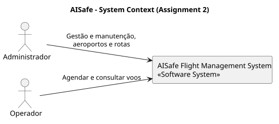

### 9.2. C4 Level 2 — Container Diagram

**Diagrama: Figura 2 — Container Architecture**

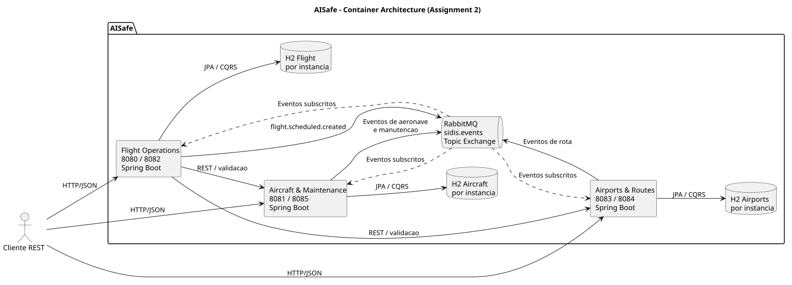

### 9.3. Logical View — Component Diagram e Class Diagrams

**Diagrama: Figura 3 — Logical Component View / CQRS**

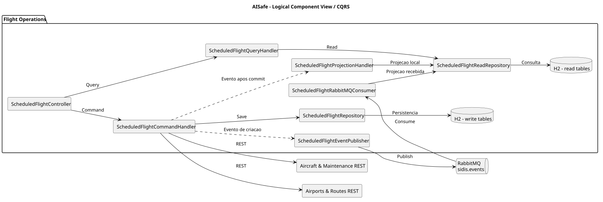

#### 9.3.1. Flight Operations

**Diagrama: Figura 4 — Flight Operations Class Diagram**

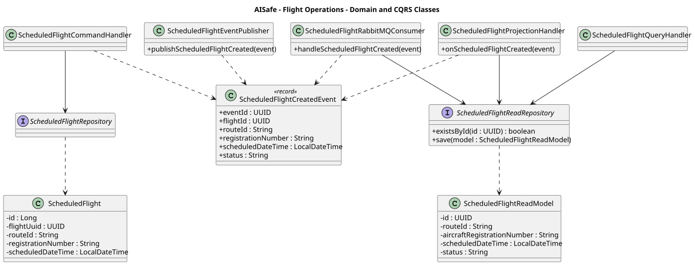

#### 9.3.2. Aircraft & Maintenance

**Diagrama: Figura 5 — Aircraft & Maintenance Class Diagram**

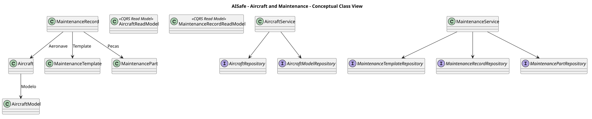

#### 9.3.3. Airports & Routes

**Diagrama: Figura 6 — Airports & Routes Class Diagram**

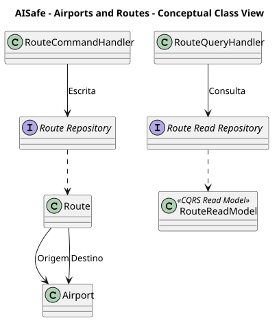

### 9.4. Development View

**Diagrama: Figura 7 — Development View**

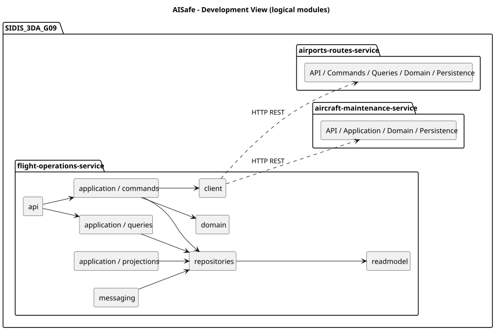

### 9.5. Physical View — Deployment Diagram

**Diagrama: Figura 8 — Physical Deployment**

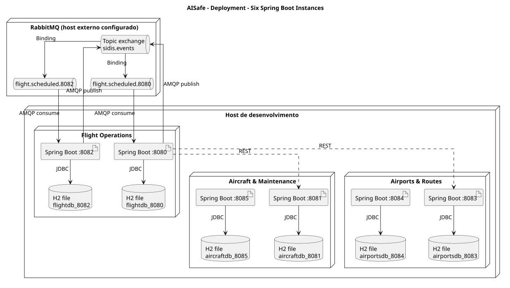

### 9.6. Cenários-chave (+1) — Sequence Diagrams

#### 9.6.1. Criação de um voo agendado

**Diagrama: Figura 9 — Create Scheduled Flight**

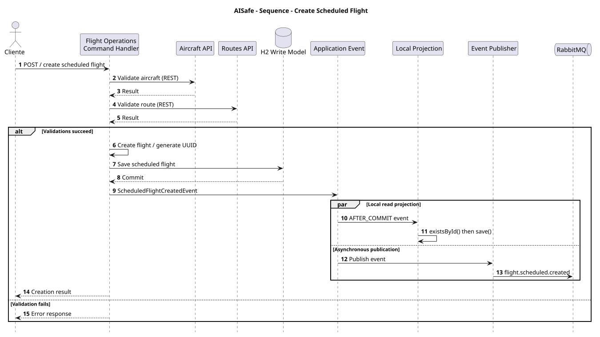

#### 9.6.2. Sincronização CQRS entre instâncias

**Diagrama: Figura 10 — CQRS Replication 8080 to 8082**

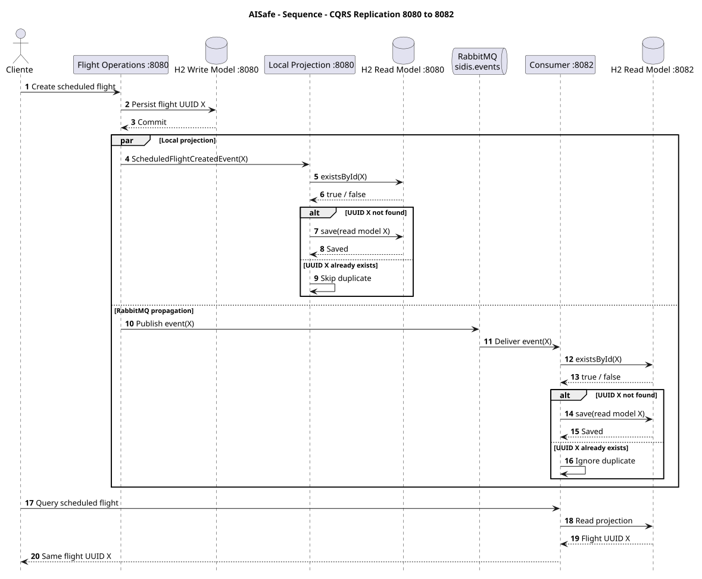

#### 9.6.3. Recuperação de consumidores RabbitMQ

**Diagrama: Figura 11 — Offline Consumer and Recovery**

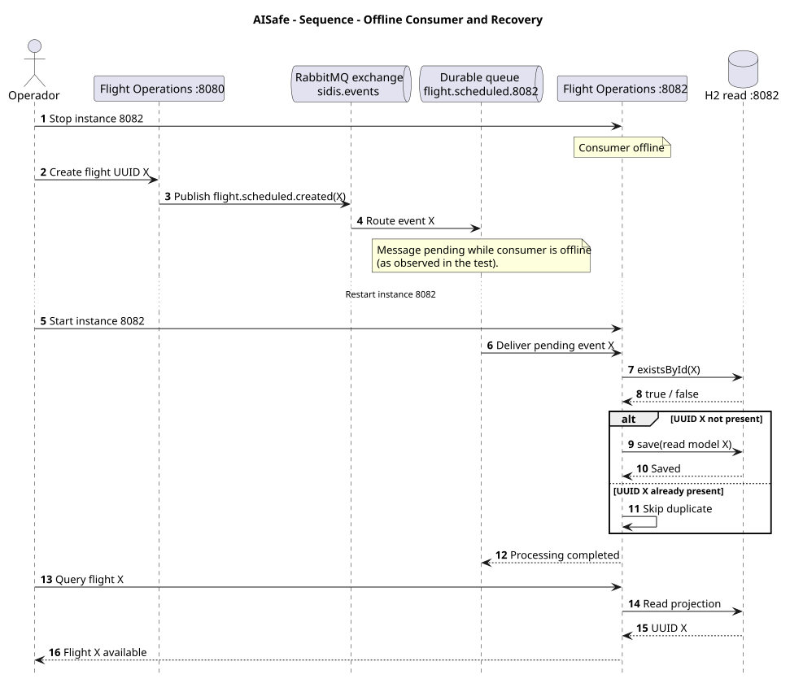

## 10. Limitações e trabalho futuro

O protótipo foi desenvolvido para demonstrar princípios de sistemas distribuídos em ambiente académico. As principais limitações conhecidas são a dependência de validações REST síncronas, a consistência eventual das projeções, a inexistência de uma garantia de publicação atómica entre base de dados e broker e a proteção limitada contra processamento simultâneo de eventos duplicados.

Como evoluções **opcionais**, poderiam ser estudados Transactional Outbox, *inbox* para deduplicação por `eventId`, políticas de retry/dead-letter, métricas de consumidores e reconstrução controlada de projeções.

## 11. Conclusão

O Assignment 2 consolida a evolução do AISafe para uma arquitetura de microserviços com responsabilidades de domínio separadas, persistência independente e comunicação híbrida REST/AMQP. A introdução de CQRS permite distinguir alterações de estado de consultas e utilizar projeções específicas de leitura. O RabbitMQ acrescenta propagação assíncrona de eventos entre instâncias, tendo sido demonstrada, no Flight Operations, a sincronização bidirecional de voos identificados por UUID e a recuperação de mensagens após indisponibilidade temporária de um consumidor.

## 12. Referências e artefactos

### Material teórico da unidade curricular

- [*Microservices Architecture: Foundations and Motivations — Introduction to Microservices*](../Documentacao/Microservices%20Architecture-%20Foundations%20and%20Motivations%20-%20Introduction%20to%20microservices.pdf)
- [*Microservices Architecture: Principles, Polyglot Persistence, and Event Sourcing*](../Documentacao/Microservices%20Architecture-%20Principles,%20Polyglot%20Persistence,%20and%20Event%20Sourcing%20(1).pdf)
- [*Event Sourcing and the Saga Pattern in Microservices*](../Documentacao/Event%20Sourcing%20and%20the%20Saga%20Pattern%20in%20Microservices%20(1).pdf)
- [*Advanced Microservices Communication and Patterns*](../Documentacao/Advanced%20Microservices%20Communication%20and%20Patterns%20(1).pdf)

